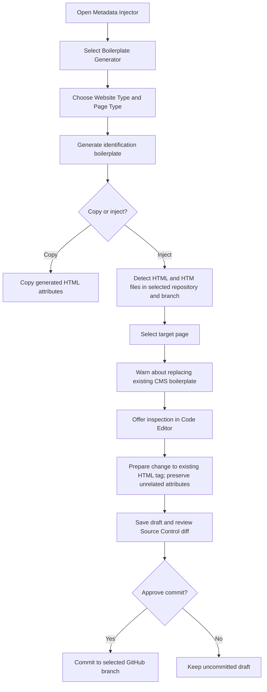
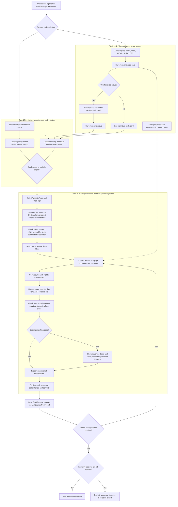

# Luxraj CMS — Revised Metadata Injector Plan

Status: Working planning notes; not implementation authorization.
Started: 2026-11-22.


## Task 15 — Boilerplate Generator 

### Location and navigation
- Clicking **Metadata Injector** (Now will be Code Injector) in the primary CMS sidebar opens its viewport.
- That viewport enables a new, feature-specific sidebar.
- The first item in the new sidebar is **Boilerplate Generator**.

  

### Generator
1. Present dropdowns to choose **Website Type** and **Page Type**.
2. Produce a copyable HTML boilerplate based on those selections.
3. The boilerplate identifies the page for later CMS discovery, using the agreed structure:

```html
<html lang="en"
      data-cms-seo="true"
      data-cms-website="blog"
      data-cms-seo-type="BlogPosting">
```

The above category and page type are examples; actual attributes reflect selected dropdown values. The generator provides a **Copy** action.

### Repository discovery and targeted injection
4. Below the copyable boilerplate, offer **Detect all HTML/HTM files from the repository**.
5. Fetch `.html` and `.htm` files from the **currently selected GitHub repository and branch** and show a list of discovered HTML pages.
6. Let the user select a particular discovered page and click **Inject**.
7. The injection process modifies the selected file's **existing opening `<html>` element** with the generated identification attributes, rather than inserting a duplicate `<html>` element or corrupting the document structure. Preserve unrelated HTML attributes and surrounding code.
8. Warn the user before injection that the operation may **replace any previous CMS boilerplate** on that page.
9. Offer the user the option to **open the file in the existing Code Editor** to inspect the HTML before proceeding.

### Existing project-wide change-control requirements retained
- The injection action prepares a proposed code change; it must follow the already established shared draft, Source Control diff/review, and **explicit approval before GitHub commit** process.
- Operations stay scoped to the selected repository and branch.
- Do not automatically edit unrelated files.

### Superseded approach
- The earlier Task 15 requirement that the user must manually paste identification attributes is replaced by **copy OR CMS-assisted injection**, at the user's choice.
- The earlier prohibition on the CMS injecting the identification boilerplate is superseded for this specific, explicitly user-triggered Task 15 action.


**Task 15 JSON integration and file locations:** This planning document remains in `LuxrajKayal/luxraj-portfolio` (`main`). The working-sheet configuration has been moved to [`LuxrajKayal/Luxraj-CMS/docs/Luxraj_CMS_Working_Sheet_Config.json`](https://github.com/LuxrajKayal/Luxraj-CMS/blob/main/docs/Luxraj_CMS_Working_Sheet_Config.json) on `main`. For implementation, use the JSON `website_categories`, `page_categories`, and `generator` data to drive Task 15 website/page selection and boilerplate generation.


## Task 16 — Code Injector (agreed, divided into three segments)

**Location:** **Code Injector** is the second option in the Metadata Injector viewport's dedicated sidebar, after **Boilerplate Generator** (Task 15). This feature has a main code preview/editor area and a right-side control window. Code Injector uses the identification boilerplate created in Task 15; it does not decide page categories from directory or file names.

### Task 16.1 — Right Control Window: Code Templates and Saved Groups

**A. Save an individual code template**
1. In the Code Injector's **right control window**, click **Code Template → Add**.
2. Enter a **name** for the code template.
3. Paste or write the **code to inject** in a text box.
4. Choose its **code type** from the dropdown: **HTML**, **Script**, or **CSS**.
5. Click **Save**.
6. Display the saved code as a **compact/narrow card** showing its **name**, **code type**, and **number of code items** in the saved block. The counting rule for nested or multi-element code remains to be finalized; a line does not necessarily equal one item.
7. Retain the individual code template for later selection and reuse.

**B. Create a reusable saved group**
1. In the same right control window, choose **Create New Group**.
2. Enter a **group name** (for example, `SEO Code` or `Schema Code`).
3. Select the **existing saved code templates/cards** that belong in the group.
4. Click **Save**.
5. The resulting group is a **reusable bulk-injectable template collection**. Users can select either a **single code template** or a **saved group** in the injection workflow. Group membership does not erase or combine the original saved code templates.

**C. Presence-aware code cards**
- Code template cards in the right control window show match status **against the currently selected source file**, regardless of its supported text-based file extension; update statuses when the selected file changes.
- **Green tick:** all elements/script items represented by the card already match the selected file.
- **Blue tick:** some, but not all, of the card's items match the selected file.
- **No tick:** none of the items match the selected file.
- Saved-group status is determined from its constituent code templates/items under the same complete/partial/none principle.
- A presence indicator means **matching code is present**, not that its current values are SEO-correct.

### Task 16.2 — Detect Matching Pages and Source Files, Select a Code Line, and Inject

**A. Select and detect target pages or source files**
1. Open **Code Injector** and its main code preview/editor interface.
2. Select **Website Type** from a dropdown.
3. Select **Page Type** from a dropdown.
4. Click **Detect** to scan the relevant **text-based source files** in the currently selected GitHub repository and branch, including `.html`/`.htm`, `.css`, `.js` and other text source types. Do not restrict Code Injector to HTML/HTM only.
5. For **HTML pages**, support the existing Task 15 boilerplate-based matching by both `data-cms-website` and `data-cms-seo-type` (with the existing CMS eligibility identification). For non-HTML files, which generally do not contain that HTML marker, allow deliberate Super Admin selection without falsely requiring an HTML boilerplate. Do not infer a page type from filenames.
6. Let the Super Admin select the intended target source file or files. The saved code block's HTML/Script/CSS type describes the template, **not an extension-based barrier** that prohibits injection into another supported text file. The Super Admin chooses the code and insertion target.

**B. Select code and its exact insertion line**
7. Choose the saved **individual code template** or saved **group** to inject. Temporary instant-group selection is described in Task 16.3.
8. Display the **actual selected file's code in a dedicated code-lines preview window**, with **visible line numbers**. This is an **essential step**, not an optional secondary feature.
9. Let the Super Admin inspect the actual source code and click/select the **exact insertion line/location**. For HTML pages, the visible HTML structure guides placement; for other source files, use their actual displayed lines. Do not impose automatic extension-based restrictions on the Super Admin's choice.
10. Show an **insertion preview** of how the selected code will appear at that chosen line before saving. Use the existing **Code Editor** for detailed inspection/editing where needed; the line-selection window must be usable in the Code Injector workflow itself.

**C. Presence checks, warnings, and saving**
11. Before preparing insertion, inspect the selected file for matching elements or scripts using the selected code template's **element/script syntax**, not its display name and not the current value alone.
    - **HTML example:** if the template contains `<title>...</title>`, detect an existing `<title>` element regardless of its text or placeholder value.
    - **Script/JSON-LD example:** if the template contains schema `"@type": "BlogPosting"`, inspect existing JSON-LD for the matching schema type. The bare occurrence of `@type` alone is **not** proof that the same schema exists.
    - Other script and CSS syntax-aware matching rules remain to be detailed during technical refinement.
12. If a matching element/script exists, show a **warning before injection** and present the user-controlled options **Duplicate** or **Replace**. Do not silently duplicate or overwrite existing code. For multi-item templates, identify which items matched so replacement does not remove unrelated code.
13. If no match exists, allow the user to proceed with the code insertion at the selected line.
14. On confirmation, **Save Draft**, then inspect the proposed result through **Source Control** and explicitly **Commit** to the selected GitHub branch after review. Injection does not commit immediately.

**Concise primary workflow:** Open Code Injector/code preview → Select website/page type when filtering CMS-identified HTML pages, or choose target source files directly → Detect/select intended files → Choose individual code template or saved group → **Select exact code line in each target file preview** → Preview insertion / resolve duplicate-or-replace warnings → **Save Draft → Review → Commit**.

### Task 16.3 — Instant Grouping and Bulk Injection

**A. Instant grouping (unsaved)**
1. In the right control window, select **as many existing saved code blocks/cards as desired** for the current operation.
2. Treat this selection as a **temporary instant group**; **do not require a group name** and **do not save a permanent group**.
3. Let the user **inject the currently selected combination immediately through the same preview/line-selection and draft workflow**. The combination is temporary; the original code blocks remain individually saved and reusable.

**B. Bulk injection using groups or instant selection**
- A saved group or temporary instant group provides a way to inject **multiple code blocks together**.
- Support applying selected code blocks or a group to **multiple selected source files**, including identified HTML pages and other supported text-based files, in one bulk operation.
- Inspect **each target file separately** for complete, partial, or absent code matches; update its presence statuses and show conflicts before preparing changes.
- Preserve the **visible code-line preview and deliberate insertion-position selection**. When multiple files are involved, show/check insertion locations against **each actual file** rather than assuming one line number is correct for all files.
- Duplicate/Replace choices must remain explicit where existing matching items are found; bulk mode never implies silent replacement.
- Prepare a **reviewable draft/change set** listing all affected files and code changes. The user reviews the Source Control diffs and explicitly commits the approved change set.

### Shared controls, safety, and unresolved technical details
- All Code Injector actions are scoped to the active **repository and branch** and preserve unrelated source code. HTML-only boilerplate generation remains Task 15; Task 16's code injection is not limited by the target file extension.
- Source edits from single templates, saved groups, or instant groups use the existing **Save Draft → Source Control diff/review → explicit GitHub commit** workflow. The existing 20-file-per-commit limit becomes a **Super Admin Settings** value, adjustable from **1 to 100 files**, with **20 as the default**. This setting controls how many reviewed files can be included in one commit, not how many files Code Injector can detect or prepare as drafts. The trusted backend must enforce the selected limit; all current commit safety checks remain.
- If the selected source file changes between preview and commit, revalidate it rather than using stale code-line positions or overwriting remote updates.
- The exact counting definition for **number of items** on a code card, advanced CSS/script syntax matching, and edge cases for conflicts inside large multi-item groups will be defined in later technical planning. These details do not change the requirement for user-selected code-line insertion.
- Task 16 is a **planning decision**, not permission to modify the application or GitHub repository.



## Task 17 — Users & Permissions Control (agreed, 2026-11-22)

### Existing CMS location and account creation
- Use the **Users & Permissions** button/section already present in Luxraj CMS; do not create a redundant navigation module.
- The Super Admin will **manually create user accounts in Supabase**. A user-registration/creation form in the CMS is not part of this task.
- After account creation, the user should appear in the CMS Users & Permissions list for Super Admin management. List access and role changes must be authorized through the backend.

### Role-based, separate working areas
- The Super Admin can assign or change a user's role among **Author**, **Developer**, and **Advisor**.
- Each role has **its own CMS working area**, distinct from the Super Admin dashboard and management controls.
- On login, the CMS opens the role-specific workspace. Regular users **must not see the Super Admin dashboard, sidebar, privileged tools, or management controls**, nor be able to access them through direct URLs or unauthorized backend calls.
- Role describes the **position** and governs the working environment and permitted capabilities. The exact screens and controls inside Author, Developer, and Advisor workspaces will be decided separately; do not invent a detailed permission matrix yet.
- An Author may be authorized by the Super Admin to work on **multiple Blog websites**. The Super Admin establishes which websites and associated categories are available to that Author. The Author selects from those authorized website/category options; those choices connect the Supabase Markdown draft with the configured destination for eventual publication. **Keep the precise repository/branch assignment mechanism open** for later technical planning.
- A user must not receive another role's working area merely because a task is assigned to them.

### Position-based task assignment
- The Super Admin can **assign specific work to an individual user based on their assigned role/position**.
- Illustrative examples only: an **Author** writes or revises an article; a **Developer** fixes or develops a code feature; an **Advisor** reviews work or provides recommendations.
- Assigned tasks should be visible to the corresponding user **inside that user's role-specific workspace**.
- **Role** determines what workspace and controls the user may access; an assigned **task** determines the specific work expected from that person. Task assignment does not grant Super Admin privileges or change the user's role.
- When the Super Admin creates an assignment, the CMS **automatically generates a unique Task ID**; that Task ID remains associated with the task, its article submissions, and any correction/resubmission cycle.
- Creating or changing an assignment updates the corresponding Author's **Pending Tasks** and task details/status in the Author Dashboard, synchronized with the Super Admin's task controls.
- When cancelling a task, the Super Admin enters a **cancellation note**. The Author's task status becomes **Cancelled**, and the Super Admin's note is visible with that task. Both the cancellation and its note remain synchronized between the workspaces.
- When an Author completes and submits assigned work, the **Super Admin Dashboard's top-right notification area** updates. A **submission summary card** appears in the same **Users & Permissions / task-assignment section** used to assign the task. The card shows the **Task ID, Author name, submission date/time, and Author's submission comment**.
- The submission card summarizes the work; the Super Admin opens the actual article for review through the dedicated Author interface described in Task 19.

### Hold and Resume
- The Super Admin may place a user **On Hold** to stop that user from working in the CMS, and may **Resume** the user later.
- Hold is a temporary working-access restriction, not deletion of the Supabase account, role, or assigned tasks.
- Resume restores access **only within the user's existing assigned role and permissions**, subject to current authorization.
- Hold/Resume must be enforced by trusted backend authorization, not only by hiding or disabling buttons.

### Scope and boundaries
- These controls belong to the Super Admin's Users & Permissions section.
- Account creation remains a **manual Supabase action** by the owner.
- The agreed Author-specific task synchronization, submission cards, and review workflow are detailed here and in Tasks 18–19; Developer and Advisor workspace details remain to be defined separately.
- Planning only: do not change the GitHub repository, app code, README, roadmap, or Supabase configuration until separately authorized.

## Task 18 — Author Homepage and Workspace Entry (agreed, 2026-11-22)

### Task 18.1 — First-login Author Profile Creation
- After authenticating with their existing Supabase account credentials, an Author who has not completed their profile must first encounter a **mandatory Profile Creation page** before entering their Author Workspace.
- Profile fields: **name**, **gender**, **educational qualifications**, **profile picture**, and the **assigned Author role**. The role is visible but **read-only/non-removable** by the Author; it is assigned by the Super Admin under Task 17.
- Gender should offer an optional/prefer-not-to-say choice. Profile details are associated with the authenticated account.
- Profile-picture upload is **WebP only**; the Author must prepare the `.webp` image themselves. **No CMS conversion, compression, or image transformation** is required.
- Accepted image file-size range: **15 KB to 150 KB** inclusive. Recommended square image, **1:1 aspect ratio**, approximately **512 × 512 pixels**; show as a circular avatar in the CMS.
- Validate file type and size before upload and provide clear feedback for invalid files. Store the Author's submitted WebP image in **Supabase Storage**; retain it with the profile submission, pending Super Admin review.
- **Profile approval checkpoint:** After the Author submits initial profile details or later edits, notify the Super Admin in the existing **Users & Permissions Control** panel. The Super Admin reviews the submitted name, qualifications, image, and other profile fields and may **approve/apply** them or **return them for correction with reasons**. Do not automatically make pending profile changes the approved article identity.
- **Second image copy for the website:** The Super Admin defines the target **GitHub repository and author-image assets folder** in the existing **Settings** tab. After approving the profile, the CMS backend prepares a copy of the approved WebP for that folder; the Super Admin reviews the repository change and **explicitly commits** it through the existing change-control workflow. Authors do not receive GitHub write permissions.
- Maintain the **Supabase image** and the **committed website-repository image** as distinct copies. Keep the website asset path/URL associated with the approved Author profile for article generation. If the repository commit fails or is still pending, do not claim the website copy is available; do not use an unapproved or uncommitted image in generated drafts.
- **Subsequent profile updates** follow the same Super Admin review and repository-commit checkpoint. Keep previously approved profile details and image active until the replacement is approved and its required website asset is committed.
- This is the entry/profile stage, not a separate user-registration feature; the Super Admin creates accounts manually in Supabase under Task 17.

### Task 18.2 — Author Dashboard
- The Author may **log in and access their dedicated dashboard, available tools, and other permitted workspace areas even while their profile approval is pending**; do not grant access to the Super Admin dashboard. Profile creation/submission is still mandatory, and pending information is not treated as approved article identity.
- While the Author's required profile approval is pending, **block article Preview (new-tab preview) and Submit for Review**. Workspace browsing and other permitted tools remain available; unfinished Supabase drafts can still be saved. Once the Super Admin approves the required profile and the website-hosted Author image is ready under the existing asset-commit rule, those article actions become eligible, subject to normal article validation.
- Show the Author's **own created articles** and statuses, including **Draft**, **Submitted**, **Approved**, and **Rejected**.
- Show **specific tasks assigned by the Super Admin** under Task 17, their current task statuses, and a **timeline** of progress/events (including assignment and deadlines where provided).
- A newly assigned or modified task updates the Author's **Pending Tasks** and associated details automatically. A cancelled task remains visible with **Cancelled** status and the synchronized cancellation note entered by the Super Admin.
- When work is **Returned for Correction**, show the reviewer's reasons and the specific marked fields/lines needing edits. The Author opens the returned item in the **Author Workstation**, corrects it, and resubmits it under the **same Task ID**.
- Article status and assigned-task status are distinct; an assigned task can involve an article without becoming the article's publication/review status.
- Authors can open their existing drafts for continued writing or editing. They cannot access other users' private work or Super Admin controls.

### Task 18.3 — Chat, Collaboration, Presence, and Notifications
- Provide a **Chat** option in the Author workspace and a **Chat** button in the Super Admin's sidebar.
- An Author may chat with the **Super Admin** and **only those additional CMS users whom the Super Admin explicitly assigns as collaborators**. No unrestricted user-to-user messaging.
- The Super Admin can view whether an Author is **Online**, **Working**, or **Offline**, inferred automatically from real CMS connection/activity, **not a user-controlled status preference**. Authors can also view the Super Admin's online/offline presence.
- **Online** means the CMS session is connected; **Working** reflects observed activity inside the CMS; **Offline** indicates no active connection. Activity outside the CMS cannot be reliably observed.
- Preserve chats persistently: users can leave messages for offline recipients and the Super Admin/collaborator can read them when they next come online.
- **Only the Super Admin** may delete chat history; regular Authors and collaborators must not have chat-deletion permission.
- Support **in-app unread/message notifications** and optional **browser/Web Push notifications** for authorized recipients. Browser push is subject to each recipient's browser/device permission and subscription; the CMS cannot force opt-in. Even without push permission, messages remain stored and visible in chat.
- Intended architecture: authenticated Supabase-backed message storage, realtime delivery/presence, backend-enforced conversation membership/deletion permissions, and web-push infrastructure where enabled. Avoid exposing private chat content to unauthorized roles.
- Do not add unrelated SEO research integration to the Author workspace; the owner explicitly chose to defer SEO research tools.

## Task 19 — Author Workstation (agreed planning; further parts may follow)

### Task 19.1 — Word-like Article Editor, Template Rules, Validation, and Review

**Workspace and author editing**
- Add an **Author Workstation** item to the Author's role-specific sidebar.
- The Author first **selects an article category** in the Author Workstation and clicks **Create New Article**. The CMS asks Supabase to create an **Author-specific, predefined Markdown draft** associated with that selected category. This working draft is stored in Supabase and **is not yet a GitHub repository file or a published website page**.
- The new draft opens as a **Word-like writing document** in the central workspace with a **requirements/control panel on the right**. The Author works on this template-based Supabase draft, not directly on website repository files.
- Authors compose visually with permitted rich-text controls (headings, paragraphs, emphasis, lists, etc.). Authors **cannot enter or edit raw HTML/CSS**, alter code templates, or choose arbitrary typography. The Super Admin predefines supported elements, text sizes, article structure, and styling to match the target website.
- The predefined Markdown draft stores the article content and populated or pending **metadata, canonical link, breadcrumbs, and template-controlled fields**. The CMS renders the structured draft into preview HTML and later prepares the website HTML from the approved content. Article boilerplate, page type, metadata structure, canonical URL configuration, image dimensions/positions and formatting come from the Super Admin's prepared article template, not Author-written raw HTML.
- When the Author clicks **Create New Article** after selecting the category, the CMS automatically uses the **Blog** website type and the **Article - Blog** page type, with the Task 15 **`data-cms-website="blog"`** and **`data-cms-seo-type="BlogPosting"`** boilerplate. The Author selects the article category, **not** the website/page-type boilerplate.
- Each new draft is **personalized per authenticated Author**: automatically populate the **approved Author name**, **website-hosted Author image URL** (from the committed repository assets copy), and **current date as the original creation date**. The generated article includes the Author image reference. Do not use a pending/unapproved profile or uncommitted website image.
- Record the creation date once when the draft is first created; reopening or editing the draft must not reset it. Track subsequent modification dates separately. The profile data is sourced from the authenticated, approved CMS Author profile rather than manually re-entered by the Author.

**Website category, canonical URL, and breadcrumb generation**
- In the Super Admin **Settings** tab, configure the assigned Blog website's **public base URL, language/URL structure, available article categories, and their approved public paths and repository destinations**. The Author chooses an article category from the Workstation dropdown **before clicking Create New Article**. The CMS associates that category with the Supabase Markdown draft; Authors do not manually construct canonical URLs, breadcrumb paths, or repository destinations.
- Use the **approved website routing and category configuration** to populate the proposed canonical URL and matching breadcrumbs in the Author's Supabase Markdown draft as the required title becomes available. The selected category also determines the **configured destination for eventual website publication**, which the CMS or Super Admin can resolve after editorial approval. **Repository file/route detection** helps verify that destination matches the website structure; do not assume a repository file path always equals its public URL.
- Generate the article slug from **`article-` + the first two words of the entered title + `-` + the draft's creation date in `MM-DD-YY` format**. Lowercase the title words and normalize them to URL-safe hyphen-separated text. Example: title **How to Install Linux**, creation date **November 26, 2026** → `article-how-to-11-26-26`.
- Example of the resulting proposed canonical URL for the **How To** category: `https://blog.luxraj.com/en/categories/howto/article-how-to-11-26-26`. The corresponding breadcrumbs follow the same route: **Home → Categories → How To → Article Title**. This domain and route are examples until approved in Super Admin Settings.
- Populate the draft's background **canonical link** and matching **breadcrumb navigation/structured data** automatically from the same settings, category, and article slug. The canonical URL is a **proposed future public URL** until the article is published.
- Verify **URL uniqueness** before publication because articles with the same first two title words and creation date could collide. Once a published URL is finalized, reopening or editing the article must not regenerate or change it unexpectedly.

**Right-side required inputs and automatic checklist**
- The right panel contains **real mandatory input fields**, not just a checklist: specifically **Title** and **Description**, plus the requirements/counters configured by the Super Admin.
- An Author enters the **Title** in the right panel and presses **Enter**; its value updates the draft's background HTML/title mapping. The **Description** is entered in the right-panel field and likewise maps to its background metadata. These fields can remain incomplete while a private draft is saved; completion is required for submission.
- The Super Admin defines minimum target counts/required ranges for title, description, headings and article content. The UI displays **live character or word counters as appropriate to each configured field** and marks each requirement complete automatically when its threshold is satisfied.
- In the Word-like document, when the Author selects **H1, H2, H3**, etc. and writes text, the corresponding right-panel checklist measures **the actual text within that element**, not just whether a heading tag exists. For a configured H1 minimum of 50 characters, `1/50` is incomplete; `50/50`, `51/50` or more is complete/ticked. Apply the corresponding Super Admin limits to other headings and text content, including overall writing-length requirements.
- Checklist completion is computed from actual entered values and structured editor content; Authors cannot manually mark a failing automatic requirement as passed.
- All mandatory textual fields use their assigned **character/word-based validation**. **Image links are the exception:** no character-count requirement; check that a **direct image URL** has been provided and meets the relevant image-link/placement requirements.

**Images and controlled presentation**
- Authors add article images **by direct image links only**, not by uploading images into the article.
- The Super Admin defines where images may appear, the permitted image slots, and the predefined sizes/dimensions for those positions. The Author inserts an approved direct image URL into those designated slots; the CMS renders the image using the prepared template/layout.
- The Author enters the **hero image's direct URL once** in its designated field. The CMS automatically maps that single value to the visible hero image, **Open Graph `og:image`**, **X/Twitter `twitter:image`**, applicable **JSON-LD image fields**, and other image metadata required by the existing article template. The Author does not re-enter the same URL in each SEO field.
- **BlogPosting schema structure and page type** are automatically initialized during blank draft generation based on the preselected Blog / Article boilerplate. Individual values that are not yet supplied remain unfilled/placeholders until available; **publication date** is not assumed to equal draft creation date.
- Further mapping of the main **Title** and **Description** to other SEO title/description fields remains **undecided** and will be planned separately; do not assume all title or description metadata shares one value.
- Super Admin controls the article's typography and text sizes, rather than allowing Authors arbitrary font sizes or raw style changes.

**Article preview, Save Draft, and Submit**
- The Author can click **Preview** while working on the article. The CMS renders the current Supabase Markdown/template draft as a **preview-only article page in a new browser tab**. This does not create, commit, deploy, or publish a page on the website. The Author can return to the Workstation and continue editing.
- **Save Draft** stores the Author's Markdown working document and its current template fields in **Supabase**, even if required fields, word/character thresholds, images, headings, or other checklist items are unfinished. Drafts remain available for later editing through the Author Dashboard; saving never creates or changes a GitHub website file.
- **Submit to Super Admin** becomes available **only when every mandatory configured requirement is satisfied**. The CMS validates the real underlying input/content, not merely tick icons. A valid submission does not imply Super Admin approval.
- **Submit for Review** stores the completed Markdown draft and its submission state in **Supabase**, then moves the article into Super Admin review; submission does not modify the GitHub repository. The Author Dashboard reflects the article status. For assigned work, preserve the same automatically generated **Task ID**, and allow the Author to include a **submission comment**.
- Upon submission, update the **Super Admin Dashboard's top-right notification area** and the **submission card** in **Users & Permissions / task assignment** (Task ID, Author name, submission time, Author comment).

**Super Admin Author interface and review controls**
- The Super Admin has an **Author** button in their own main sidebar. It opens an article interface with the Author's writing/review functionality **plus additional Super Admin controls**, without requiring the Super Admin to log in as an Author.
- From a submitted-task summary card, the Super Admin opens the corresponding submitted article in this dedicated interface.
- The Super Admin can **mark specific lines, sections, or fields requiring refinement**, enter correction or rejection reasons in comment windows, and choose **Approve**, **Reject**, or **Return for Correction**.
- When returning a submission, synchronize the marked fields/lines and the reasons with the Author's Dashboard and Workstation. The Author edits the returned article and resubmits it for another review under the original Task ID.

**Super Admin-assigned revisions to existing articles**
- The Super Admin can select an **existing article** and assign an update task to an Author, including **comments/instructions** specifying the changes needed. The task appears in the Author Dashboard with its Task ID.
- The Author opens the **existing article** in the Workstation rather than creating a new blank article. Preserve its existing article identity, original creation/publication date, canonical URL, and breadcrumbs unless a separately approved change requires otherwise.
- When the Author submits the revised article, record the **Author's submission date as the proposed updated date** and require the Author to provide an **Update Note** describing the changes for the Super Admin's review.
- If corrections are returned and the Author resubmits, the proposed updated date follows the **latest submission date**. The live article keeps its currently published update date and content until the Super Admin approves the revision and completes the existing Code Editor publication workflow.

**Approval of new articles and edits to existing articles**
- The Super Admin reviews **both new article submissions and updates** submitted by Authors. An Author's edits to a previously approved article must again be **submitted for Super Admin approval**.
- Super Admin outcomes: **Approve**, **Reject**, or **Return for Correction**.
- When returning work, the Super Admin can **mark the precise unsatisfactory items/sections** (e.g., description, specific heading, content or image), with comments. Those marked issues are visible to the Author, who can revise, save drafts, and resubmit.
- Satisfying automatic word/character validation is **not equivalent to editorial approval**; the Super Admin may reject or return content even when counters pass.
- Maintain the existing **approved/published article version unchanged** while an Author's proposed update remains in draft/review and while an approved replacement awaits publication. Approval sends the replacement to Code Editor for the existing publishing process; it does **not** automatically replace the published version.
- Preserve the original creation date; track modification/update dates distinctly. Do not confuse draft modification with the approved/public version's update.
- Article workflow distinguishes **Draft → Submitted → Approved / Rejected**, with **Returned for Correction** leading to editing and resubmission. **Approved** is not the same as **Published**.

**New-article workflow summary**
- **Select category → Create New Article → Supabase creates personalized Markdown draft with template/metadata/canonical data → Write in Word-like Workstation → Preview in new tab → Save Draft or Submit for Review → Supabase notifies Super Admin → Comment/Return/Reject/Approve → Resolve category-based website destination → Prepare HTML → Existing Code Editor and Source Control review → Super Admin commits/publishes.**

**Approved draft handoff to Code Editor and publication**
- When satisfied with the submitted Supabase article, the Super Admin clicks **Approve** in the Super Admin Author review interface. This **does not publish** the draft.
- On approval, the CMS uses the **category saved with the article** and the Super Admin's preconfigured category-to-destination mapping to identify where the website article belongs. It prepares the corresponding **website HTML file/change** from the approved Markdown/template data at that destination. The Author is never asked to manage repository files.
- The prepared publication change becomes available through the existing **Code Editor** section, and a **small red notification dot** appears on the Code Editor sidebar item to draw the Super Admin's attention.
- The **Super Admin**, not the regular Author, opens Code Editor and reviews the generated website HTML and intended repository path through the **existing draft/change-set → Source Control diff → explicit GitHub commit** workflow. When the destination file is new, that existing commit workflow must also support **reviewed new-file additions**; do not introduce a separate publishing or commit system.
- Ordinary Authors retain their Word-like Workstation and **do not gain Code Editor or publishing permissions** through article submission or approval.

### Scope of the decision
- This records the owner's agreed high-level Author Workstation behavior; detailed later Task 19 parts remain open.
- Task 19 is a **new** plan and does not reinstate the original repository's superseded Task 19 (Missing-Placeholder Injection).
- Nothing in Tasks 18–19 authorizes changes to GitHub, the repository README/roadmap, Supabase schema/configuration, or deployed CMS until separately requested.

## Task 20 — Website Preview and Inspection (agreed planning)

- Provide a **Website Preview** interface accessible to **both Authors and the Super Admin** from their respective CMS working areas.
- Load the **existing live website** within the CMS using an **iframe**, based on the website URL configured by the Super Admin.
- Allow both roles to **navigate existing website pages, refresh the preview, and visually inspect content and layout** to identify problems on the website.
- Authors may **identify visible faults** through this preview; the feature does not grant them source-code, administrative, or publishing permissions. The Super Admin retains their existing authorized controls.
- Embedded viewing depends on whether the target website allows iframe embedding through its **Content Security Policy / frame-ancestors** and **X-Frame-Options** configuration. Do not assume the CMS can access or inspect cross-origin iframe internals automatically.
- **Fault reporting, assignment, or corrective-action workflow is not yet defined**; do not add one without a further planning decision.

## Future revisions
- Append or revise subsequent decisions only when the project owner supplies and agrees to them.
- Maintain this working document in ChatGPT Library; do not change the repository README, roadmap, or implementation.
- Deliver the complete consolidated planning document only when requested.
