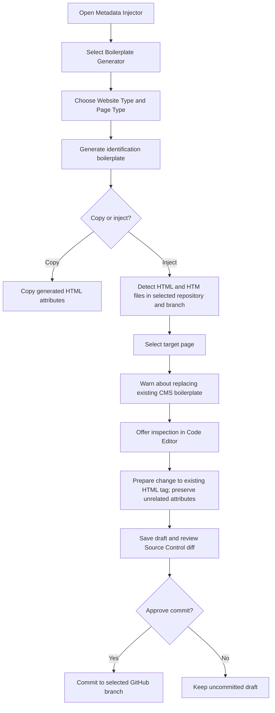

# Luxraj CMS — Revised Metadata Injector Plan

Status: Working planning notes; not implementation authorization.
Started: 2026-11-22.


## Task 15 — Boilerplate Generator 

### Location and navigation
- Clicking **Metadata Injector** (Now will be Code Injector) in the primary CMS sidebar opens its viewport.
- That viewport enables a new, feature-specific sidebar.
- The first item in the new sidebar is **Boilerplate Generator**.

  

### Generator
1. Present dropdowns to choose **Website Type** and **Page Type**.
2. Produce a copyable HTML boilerplate based on those selections.
3. The boilerplate identifies the page for later CMS discovery, using the agreed structure:

```html
<html lang="en"
      data-cms-seo="true"
      data-cms-website="blog"
      data-cms-seo-type="BlogPosting">
```

The above category and page type are examples; actual attributes reflect selected dropdown values. The generator provides a **Copy** action.

### Repository discovery and targeted injection
4. Below the copyable boilerplate, offer **Detect all HTML/HTM files from the repository**.
5. Fetch `.html` and `.htm` files from the **currently selected GitHub repository and branch** and show a list of discovered HTML pages.
6. Let the user select a particular discovered page and click **Inject**.
7. The injection process modifies the selected file's **existing opening `<html>` element** with the generated identification attributes, rather than inserting a duplicate `<html>` element or corrupting the document structure. Preserve unrelated HTML attributes and surrounding code.
8. Warn the user before injection that the operation may **replace any previous CMS boilerplate** on that page.
9. Offer the user the option to **open the file in the existing Code Editor** to inspect the HTML before proceeding.

### Existing project-wide change-control requirements retained
- The injection action prepares a proposed code change; it must follow the already established shared draft, Source Control diff/review, and **explicit approval before GitHub commit** process.
- Operations stay scoped to the selected repository and branch.
- Do not automatically edit unrelated files.

### Superseded approach
- The earlier Task 15 requirement that the user must manually paste identification attributes is replaced by **copy OR CMS-assisted injection**, at the user's choice.
- The earlier prohibition on the CMS injecting the identification boilerplate is superseded for this specific, explicitly user-triggered Task 15 action.


**Task 15 JSON integration and file locations:** In `LuxrajKayal/luxraj-portfolio` (`main`), this planning file is `/Luxraj_CMS_Revised_Metadata_Injector_Living_Plan.md` and its configuration file is `/Luxraj_CMS_Working_Sheet_Config.json`; when both are later copied into the same Luxraj-CMS directory, use the JSON `website_categories`, `page_categories`, and `generator` data to drive Task 15 website/page selection and boilerplate generation .


## Task 16 — Code Injector (agreed, divided into three segments)

**Location:** **Code Injector** is the second option in the Metadata Injector viewport's dedicated sidebar, after **Boilerplate Generator** (Task 15). This feature has a main code preview/editor area and a right-side control window. Code Injector uses the identification boilerplate created in Task 15; it does not decide page categories from directory or file names.

### Task 16.1 — Right Control Window: Code Templates and Saved Groups

**A. Save an individual code template**
1. In the Code Injector's **right control window**, click **Code Template → Add**.
2. Enter a **name** for the code template.
3. Paste or write the **code to inject** in a text box.
4. Choose its **code type** from the dropdown: **HTML**, **Script**, or **CSS**.
5. Click **Save**.
6. Display the saved code as a **compact/narrow card** showing its **name**, **code type**, and **number of code items** in the saved block. The counting rule for nested or multi-element code remains to be finalized; a line does not necessarily equal one item.
7. Retain the individual code template for later selection and reuse.

**B. Create a reusable saved group**
1. In the same right control window, choose **Create New Group**.
2. Enter a **group name** (for example, `SEO Code` or `Schema Code`).
3. Select the **existing saved code templates/cards** that belong in the group.
4. Click **Save**.
5. The resulting group is a **reusable bulk-injectable template collection**. Users can select either a **single code template** or a **saved group** in the injection workflow. Group membership does not erase or combine the original saved code templates.

**C. Presence-aware code cards**
- Code template cards in the right control window show match status **against the currently selected HTML file**; update the statuses when the user changes the selected file.
- **Green tick:** all elements/script items represented by the card already match the selected file.
- **Blue tick:** some, but not all, of the card's items match the selected file.
- **No tick:** none of the items match the selected file.
- Saved-group status is determined from its constituent code templates/items under the same complete/partial/none principle.
- A presence indicator means **matching code is present**, not that its current values are SEO-correct.

### Task 16.2 — Detect Matching Pages, Select a Code Line, and Inject

**A. Select and detect target HTML pages**
1. Open **Code Injector** and its main code preview/editor interface.
2. Select **Website Type** from a dropdown.
3. Select **Page Type** from a dropdown.
4. Click **Detect** to scan `.html` and `.htm` files in the **currently selected GitHub repository and branch**.
5. Match the **existing Task 15 boilerplate** by both `data-cms-website` and `data-cms-seo-type` (with the existing CMS eligibility identification), and display only matching HTML pages.
6. Choose the **preferred detected HTML page** using the page-selection menu.

**B. Select code and its exact insertion line**
7. Choose the saved **individual code template** or saved **group** to inject. Temporary instant-group selection is described in Task 16.3.
8. Display the **actual selected file's code in a dedicated code-lines preview window**, with **visible line numbers**. This is an **essential step**, not an optional secondary feature.
9. Let the user inspect the source code, click/select the **exact code line/insertion location** where the code should be placed, and recognize the intended location from the visible HTML structure.
10. Show an **insertion preview** of how the selected code will appear at that chosen line before saving. Use the existing **Code Editor** for detailed inspection/editing where needed; the line-selection window must be usable in the Code Injector workflow itself.

**C. Presence checks, warnings, and saving**
11. Before preparing insertion, inspect the selected file for matching elements or scripts using the selected code template's **element/script syntax**, not its display name and not the current value alone.
    - **HTML example:** if the template contains `<title>...</title>`, detect an existing `<title>` element regardless of its text or placeholder value.
    - **Script/JSON-LD example:** if the template contains schema `"@type": "BlogPosting"`, inspect existing JSON-LD for the matching schema type. The bare occurrence of `@type` alone is **not** proof that the same schema exists.
    - Other script and CSS syntax-aware matching rules remain to be detailed during technical refinement.
12. If a matching element/script exists, show a **warning before injection** and present the user-controlled options **Duplicate** or **Replace**. Do not silently duplicate or overwrite existing code. For multi-item templates, identify which items matched so replacement does not remove unrelated code.
13. If no match exists, allow the user to proceed with the code insertion at the selected line.
14. On confirmation, **Save Draft**, then inspect the proposed result through **Source Control** and explicitly **Commit** to the selected GitHub branch after review. Injection does not commit immediately.

**Concise primary workflow:** Open Code Injector/code preview → Select website type and page type → Detect matching pages → Select preferred page → Choose individual code template or saved group → **Select exact code line in preview** → Preview insertion / resolve duplicate-or-replace warnings → **Save Draft → Review → Commit**.

### Task 16.3 — Instant Grouping and Bulk Injection

**A. Instant grouping (unsaved)**
1. In the right control window, select **as many existing saved code blocks/cards as desired** for the current operation.
2. Treat this selection as a **temporary instant group**; **do not require a group name** and **do not save a permanent group**.
3. Let the user **inject the currently selected combination immediately through the same preview/line-selection and draft workflow**. The combination is temporary; the original code blocks remain individually saved and reusable.

**B. Bulk injection using groups or instant selection**
- A saved group or temporary instant group provides a way to inject **multiple code blocks together**.
- Support applying selected code blocks or a group to **multiple detected matching HTML pages** in one bulk operation when the user selects multiple pages.
- Inspect **each target file separately** for complete, partial, or absent code matches; update its presence statuses and show conflicts before preparing changes.
- Preserve the **visible code-line preview and deliberate insertion-position selection**. When multiple files are involved, show/check insertion locations against **each actual file** rather than assuming one line number is correct for all files.
- Duplicate/Replace choices must remain explicit where existing matching items are found; bulk mode never implies silent replacement.
- Prepare a **reviewable draft/change set** listing all affected files and code changes. The user reviews the Source Control diffs and explicitly commits the approved change set.

### Shared controls, safety, and unresolved technical details
- All Code Injector actions are scoped to the active **repository and branch** and preserve unrelated HTML, CSS, and script code.
- Source edits from single templates, saved groups, or instant groups use the existing **Save Draft → Source Control diff/review → explicit GitHub commit** workflow.
- If the selected source file changes between preview and commit, revalidate it rather than using stale code-line positions or overwriting remote updates.
- The exact counting definition for **number of items** on a code card, advanced CSS/script syntax matching, and edge cases for conflicts inside large multi-item groups will be defined in later technical planning. These details do not change the requirement for user-selected code-line insertion.
- Task 16 is a **planning decision**, not permission to modify the application or GitHub repository.

## Decision — Original repository Tasks 17–19 superseded (2026-11-22)

- The previous GitHub roadmap's **Task 17 — Page Type Injection**, **Task 18 — Placeholder Verification**, and **Task 19 — Missing-Placeholder Injection** are **no longer part of the revised development plan as standalone tasks**.
- Their original workflows and requirements are **not retained as separate feature commitments**. Any similar behavior now desired is defined only by the expressly agreed revised Tasks 15 and 16, not inherited from the old roadmap.
- **Task numbers 17, 18, and 19 are available for entirely new plans**, to be defined later by the project owner. Do not invent replacement features yet.
- This decision applies to the **Library working plan only**. The existing GitHub README, DEVELOPMENT_ROADMAP, source code, and other repository files are unchanged until the project owner specifically authorizes an update.

## Task 17 — Users & Permissions Control (agreed, 2026-11-22)

### Existing CMS location and account creation
- Use the **Users & Permissions** button/section already present in Luxraj CMS; do not create a redundant navigation module.
- The Super Admin will **manually create user accounts in Supabase**. A user-registration/creation form in the CMS is not part of this task.
- After account creation, the user should appear in the CMS Users & Permissions list for Super Admin management. List access and role changes must be authorized through the backend.

### Role-based, separate working areas
- The Super Admin can assign or change a user's role among **Author**, **Developer**, and **Advisor**.
- Each role has **its own CMS working area**, distinct from the Super Admin dashboard and management controls.
- On login, the CMS opens the role-specific workspace. Regular users **must not see the Super Admin dashboard, sidebar, privileged tools, or management controls**, nor be able to access them through direct URLs or unauthorized backend calls.
- Role describes the **position** and governs the working environment and permitted capabilities. The exact screens and controls inside Author, Developer, and Advisor workspaces will be decided separately; do not invent a detailed permission matrix yet.
- A user must not receive another role's working area merely because a task is assigned to them.

### Position-based task assignment
- The Super Admin can **assign specific work to an individual user based on their assigned role/position**.
- Illustrative examples only: an **Author** writes or revises an article; a **Developer** fixes or develops a code feature; an **Advisor** reviews work or provides recommendations.
- Assigned tasks should be visible to the corresponding user **inside that user's role-specific workspace**.
- **Role** determines what workspace and controls the user may access; an assigned **task** determines the specific work expected from that person. Task assignment does not grant Super Admin privileges or change the user's role.
- Exact task lifecycle, fields, statuses, and any submission/review features are **not yet specified**; do not add them without further owner direction.

### Hold and Resume
- The Super Admin may place a user **On Hold** to stop that user from working in the CMS, and may **Resume** the user later.
- Hold is a temporary working-access restriction, not deletion of the Supabase account, role, or assigned tasks.
- Resume restores access **only within the user's existing assigned role and permissions**, subject to current authorization.
- Hold/Resume must be enforced by trusted backend authorization, not only by hiding or disabling buttons.

### Scope and boundaries
- These controls belong to the Super Admin's Users & Permissions section.
- Account creation remains a **manual Supabase action** by the owner.
- Do not presume that the detailed Author/Developer/Advisor workspace contents or task-management workflow are already approved.
- Planning only: do not change the GitHub repository, app code, README, roadmap, or Supabase configuration until separately authorized.

## Task 18 — Author Homepage and Workspace Entry (agreed, 2026-11-22)

### Task 18.1 — First-login Author Profile Creation
- After authenticating with their existing Supabase account credentials, an Author who has not completed their profile must first encounter a **mandatory Profile Creation page** before entering their Author Workspace.
- Profile fields: **name**, **gender**, **educational qualifications**, **profile picture**, and the **assigned Author role**. The role is visible but **read-only/non-removable** by the Author; it is assigned by the Super Admin under Task 17.
- Gender should offer an optional/prefer-not-to-say choice. Profile details are associated with the authenticated account.
- Profile-picture upload is **WebP only**; the Author must prepare the `.webp` image themselves. **No CMS conversion, compression, or image transformation** is required.
- Accepted image file-size range: **15 KB to 150 KB** inclusive. Recommended square image, **1:1 aspect ratio**, approximately **512 × 512 pixels**; show as a circular avatar in the CMS.
- Validate file type and size before upload and provide clear feedback for invalid files. Store an accepted image in Supabase Storage and retain its image URL with the Author's profile.
- This is the entry/profile stage, not a separate user-registration feature; the Super Admin creates accounts manually in Supabase under Task 17.

### Task 18.2 — Author Dashboard
- After successful login and completion of the required first-login profile, open the Author's **dedicated dashboard**, not the Super Admin dashboard.
- Show the Author's **own created articles** and statuses, including **Draft**, **Submitted**, **Approved**, and **Rejected**.
- Show **specific tasks assigned by the Super Admin** under Task 17, their current task statuses, and a **timeline** of progress/events (including assignment and deadlines where provided).
- Article status and assigned-task status are distinct; an assigned task can involve an article without becoming the article's publication/review status.
- Authors can open their existing drafts for continued writing or editing. They cannot access other users' private work or Super Admin controls.

### Task 18.3 — Chat, Collaboration, Presence, and Notifications
- Provide a **Chat** option in the Author workspace and a **Chat** button in the Super Admin's sidebar.
- An Author may chat with the **Super Admin** and **only those additional CMS users whom the Super Admin explicitly assigns as collaborators**. No unrestricted user-to-user messaging.
- The Super Admin can view whether an Author is **Online**, **Working**, or **Offline**, inferred automatically from real CMS connection/activity, **not a user-controlled status preference**. Authors can also view the Super Admin's online/offline presence.
- **Online** means the CMS session is connected; **Working** reflects observed activity inside the CMS; **Offline** indicates no active connection. Activity outside the CMS cannot be reliably observed.
- Preserve chats persistently: users can leave messages for offline recipients and the Super Admin/collaborator can read them when they next come online.
- **Only the Super Admin** may delete chat history; regular Authors and collaborators must not have chat-deletion permission.
- Support **in-app unread/message notifications** and optional **browser/Web Push notifications** for authorized recipients. Browser push is subject to each recipient's browser/device permission and subscription; the CMS cannot force opt-in. Even without push permission, messages remain stored and visible in chat.
- Intended architecture: authenticated Supabase-backed message storage, realtime delivery/presence, backend-enforced conversation membership/deletion permissions, and web-push infrastructure where enabled. Avoid exposing private chat content to unauthorized roles.
- Do not add unrelated SEO research integration to the Author workspace; the owner explicitly chose to defer SEO research tools.

## Task 19 — Author Workstation (agreed planning; further parts may follow)

### Task 19.1 — Word-like Article Editor, Template Rules, Validation, and Review

**Workspace and author editing**
- Add an **Author Workstation** item to the Author's role-specific sidebar.
- Creating a blank article opens a **Word-like writing document** in the central workspace and a **requirements/control panel on the right**.
- Authors compose visually with permitted rich-text controls (headings, paragraphs, emphasis, lists, etc.). Authors **cannot enter or edit raw HTML/CSS**, alter code templates, or choose arbitrary typography. The Super Admin predefines supported elements, text sizes, article structure, and styling to match the target website.
- The CMS transforms the structured document content into the corresponding **background HTML**. Predefined article boilerplate, page type, metadata structure, canonical URL configuration, image dimensions/positions and formatting come from the Super Admin's prepared article draft/template rather than the Author's own HTML.
- Each blank document is automatically prefilled server-side with the authenticated **Author's name, profile-picture image URL, and creation date**. Record creation date once; update modification dates when the document changes. Author information is sourced from the authenticated CMS profile, not typed afresh in the editor.

**Right-side required inputs and automatic checklist**
- The right panel contains **real mandatory input fields**, not just a checklist: specifically **Title** and **Description**, plus the requirements/counters configured by the Super Admin.
- An Author enters the **Title** in the right panel and presses **Enter**; its value updates the draft's background HTML/title mapping. The **Description** is entered in the right-panel field and likewise maps to its background metadata. These fields can remain incomplete while a private draft is saved; completion is required for submission.
- The Super Admin defines minimum target counts/required ranges for title, description, headings and article content. The UI displays **live character or word counters as appropriate to each configured field** and marks each requirement complete automatically when its threshold is satisfied.
- In the Word-like document, when the Author selects **H1, H2, H3**, etc. and writes text, the corresponding right-panel checklist measures **the actual text within that element**, not just whether a heading tag exists. For a configured H1 minimum of 50 characters, `1/50` is incomplete; `50/50`, `51/50` or more is complete/ticked. Apply the corresponding Super Admin limits to other headings and text content, including overall writing-length requirements.
- Checklist completion is computed from actual entered values and structured editor content; Authors cannot manually mark a failing automatic requirement as passed.
- All mandatory textual fields use their assigned **character/word-based validation**. **Image links are the exception:** no character-count requirement; check that a **direct image URL** has been provided and meets the relevant image-link/placement requirements.

**Images and controlled presentation**
- Authors add article images **by direct image links only**, not by uploading images into the article.
- The Super Admin defines where images may appear, the permitted image slots, and the predefined sizes/dimensions for those positions. The Author inserts an approved direct image URL into those designated slots; the CMS renders the image using the prepared template/layout.
- Super Admin controls the article's typography and text sizes, rather than allowing Authors arbitrary font sizes or raw style changes.

**Save Draft versus Submit**
- **Save Draft** must work even if required fields, word/character thresholds, images, headings, or other checklist items are unfinished. Drafts retain unfinished work for later editing through the Author Dashboard.
- **Submit to Super Admin** becomes available **only when every mandatory configured requirement is satisfied**. The CMS validates the real underlying input/content, not merely tick icons. A valid submission does not imply Super Admin approval.
- Submission moves an article into review; the Author's dashboard reflects the article status.

**Approval of new articles and edits to existing articles**
- The Super Admin reviews **both new article submissions and updates** submitted by Authors. An Author's edits to a previously approved article must again be **submitted for Super Admin approval**.
- Super Admin outcomes: **Approve**, **Reject**, or **Return for Correction**.
- When returning work, the Super Admin can **mark the precise unsatisfactory items/sections** (e.g., description, specific heading, content or image), with comments. Those marked issues are visible to the Author, who can revise, save drafts, and resubmit.
- Satisfying automatic word/character validation is **not equivalent to editorial approval**; the Super Admin may reject or return content even when counters pass.
- Maintain an existing **approved article version unchanged** while an Author's proposed update remains in draft/review. Apply the replacement version only after Super Admin approval.
- Preserve the original creation date; track modification/update dates distinctly. Do not confuse draft modification with the approved/public version's update.
- Article workflow statuses include **Draft → Submitted → Approved / Rejected**, with **Returned for Correction** as a distinct review outcome leading to further editing and resubmission.

### Scope of the decision
- This records the owner's agreed high-level Author Workstation behavior; detailed later Task 19 parts remain open.
- Task 19 is a **new** plan and does not reinstate the original repository's superseded Task 19 (Missing-Placeholder Injection).
- Nothing in Tasks 18–19 authorizes changes to GitHub, the repository README/roadmap, Supabase schema/configuration, or deployed CMS until separately requested.

## Future revisions
- Append or revise subsequent decisions only when the project owner supplies and agrees to them.
- Maintain this working document in ChatGPT Library; do not change the repository README, roadmap, or implementation.
- Deliver the complete consolidated planning document only when requested.
